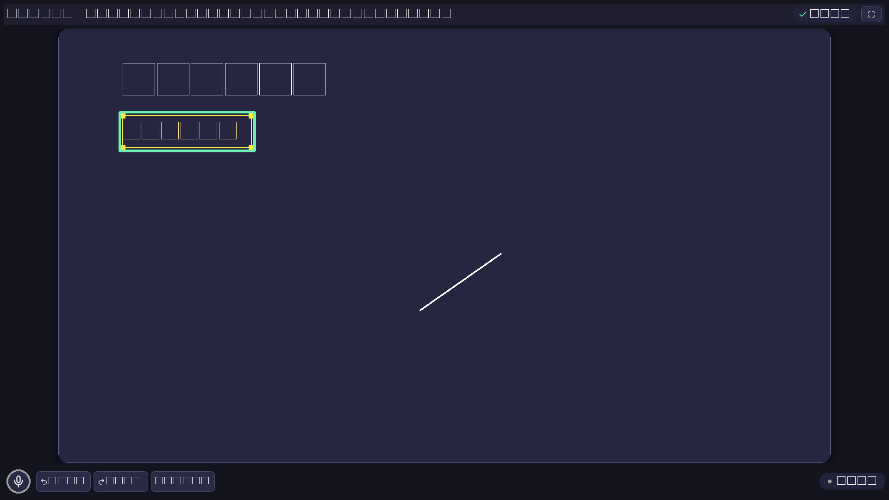

<h1 align="center">Smart Chalkboard</h1>

<p align="center">
  A deterministic, voice-driven classroom whiteboard on an <b>infinite, pannable, zoomable board</b>.<br>
  Speak commands, draw with a pen, and edit text inline — every change flows through one validated engine.
</p>

<p align="center">
  
  
  
  
  
</p>

<p align="center">
  <a href="#-quick-start">Quick start</a> •
  <a href="#-features">Features</a> •
  <a href="#-board-controls">Controls</a> •
  <a href="#-architecture">Architecture</a> •
  <a href="#-testing">Testing</a> •
  <a href="#-troubleshooting">Troubleshooting</a>
</p>

---

## 📸 Screenshot



*Edgeless infinite board with dot grid, equation content, voice transcription strip, and zoom controls.*

---

## 🚀 Quick start

```powershell
git clone https://github.com/MohamedMamdouh808/Smart-Chalkboard-MVP
cd Smart-Chalkboard-MVP
setup.bat          # double-click: creates .venv, installs requirements, copies .env
# open .env and paste your GROQ_API_KEY
start.bat          # double-click: launches the board
```

---

## ✨ Features

### ♾️ Infinite board

- **Edgeless world** — elements live in unbounded world coordinates from `(0,0)`; no page edge, no canvas to outgrow.
- **Application-owned camera** — pan offset + zoom (`10%–400%`) is view state, never board content. Camera moves never touch the board, version, selection, or Undo history.
- **Pan** — `Space`+drag (Pen and Select modes), middle-mouse drag, wheel/touchpad scroll, `Shift`+wheel horizontal, Select-mode empty-space drag.
- **Zoom** — `Ctrl`+wheel and pinch around the pointer, zoom buttons, `Ctrl`+`+` / `Ctrl`+`-`, `Ctrl`+`0` reset, `Shift`+`1` Fit-all, live zoom-% indicator.
- **Dot grid** that pans and zooms with the camera, plus **viewport culling** (only visible elements painted; 200-element target).

### ✏️ Direct text creation and inline editing

- **Double-click empty space** (Select mode) to create text exactly there and start typing.
- **Double-click text, headings, or equations** to edit in place.
- `Enter` / click-outside commits · `Shift`+`Enter` newline · `Escape` discards silently with **zero history side effects**.
- Each accepted creation/edit is engine-validated and recorded as **exactly one Undo entry**.

### 🎙️ Voice commands

- **Press-and-hold mic button** (`Listening` → `Processing`), local Whisper STT (`base.en`, CPU/int8), memory-only audio.
- New elements land **in the visible viewport** (top-left, below nearby content); relative moves ("move left") use **zoom-scaled world units**.
- Short, viewport-aware AI context (≤ **50 compact summaries**, no stroke data/audio/secrets); ambiguous input asks instead of guessing; destructive actions need confirmation.

### 🖊️ Pen drawing and direct manipulation

- Pressure-aware pen/mouse/touch drawing with stroke grouping — **fully offline capable**.
- World-coordinate strokes with constant world-unit widths at any zoom.
- **Drag-to-move** and **corner-handle resize** with live previews, one history entry on release, `Escape` cancels.
- Selection outlines and handles stay **constant on-screen size** from 10% to 400%.

### ⚙️ Deterministic engine

- One `CommandEngine` is the **sole board-state writer**; AI, pen, gestures, and edits all pass validation plus a FIFO queue under one lock.
- Closed **12-command AI schema** (internal pen/text ops are engine entry points, never AI-addressable).
- Atomic commands, snapshot Undo/Redo (100 steps), typed errors (`E_SCHEMA`, `E_OUT_OF_BOUNDS`, `E_AMBIGUOUS`, …).

### 💾 Lessons, export, theming

- SQLite lessons storing **board content + camera**; reopening restores both.
- Legacy fixed-canvas lessons migrate with **coordinates preserved** (centered 100% view).
- PNG export of **content bounds + margin at 100%**; dark theme, styled tooltips, contrast-checked palette.

---

## 🎮 Board controls

| Action | Input |
|---|---|
| Pan | `Space`+drag · middle-mouse drag · wheel scroll · `Shift`+wheel (horizontal) · Select-mode empty-space drag |
| Zoom around pointer | `Ctrl`+wheel · pinch · `+`/`-` buttons · `Ctrl`+`+` / `Ctrl`+`-` |
| Reset zoom (100%) | `100%` button · `Ctrl`+`0` |
| Fit all content | `Fit` button · `Shift`+`1` |
| Create text | Double-click empty space (Select mode) |
| Edit text / heading / equation | Double-click the element |
| Commit edit | `Enter` or click outside |
| Cancel edit | `Escape` |
| Draw | Pen mode: press and drag |
| Move / resize | Select mode: drag body / corner handle |
| Cancel gesture | `Escape` |
| Undo / Redo | Toolbar buttons |
| Voice command | Press and hold the mic button |
| Pen / Select mode | `P` / `S` or mode button |
| Fullscreen | `F11` |

---

## 🤖 AI command contract

The AI emits **exactly one JSON object** per transcript — `{command, target_id, parameters, timestamp}` — using only:

| Command | Purpose |
|---|---|
| `create_heading` | Heading (1–200 chars) |
| `create_text` | Body / equation text (1–2000 chars) |
| `move_item` | Absolute position or relative direction + distance |
| `resize_item` | Scale 0.25–4.0 or size (min 24×24) |
| `delete_item` | Delete target (needs confirmation) |
| `clear_board` | Clear all (needs confirmation) |
| `create_shape` | rectangle / circle / line / arrow / triangle |
| `change_color` | Palette name or `#RRGGBB` |
| `undo` / `redo` | History navigation |
| `save_lesson` / `new_lesson` | Lesson actions |

Unknown commands, shapes, colors, sizes, and out-of-range world values are rejected with typed errors — state and history untouched.

---

## 🏗️ Architecture

```text
src/smartboard/
├── core/          UI-independent model, schema, validation, engine, history
│   ├── board.py        Board/Element, unbounded world geometry, numeric guards
│   ├── engine.py       CommandEngine: sole writer, validation, undo/redo
│   ├── validators.py   Per-command validation, finite world-limit checks
│   ├── gesture.py      Drag/resize candidate geometry (no UI, no canvas)
│   ├── hit_test.py     Type-specific hit testing, zoom-scaled tolerance
│   ├── command_schema.py  Locked 12-command envelope validation
│   ├── history.py      100-step inverse-based undo/redo
│   └── errors.py       Typed codes + teacher-friendly messages
├── app/           Camera ownership, queue, wiring
│   ├── camera.py       CameraState, pan/zoom/fit math, normalization
│   ├── orchestrator.py FIFO queue + engine lock, voice normalization
│   ├── placement.py    Deterministic visible-viewport default placement
│   ├── lesson_document.py  Board+camera snapshot envelope + migration
│   ├── exporter.py     Content-bounds PNG export (read-only)
│   └── main.py         Entry point and widget wiring
├── ai/            Providers, prompt, viewport-scoped context (≤50 summaries)
├── voice/         Recorder, Whisper service/worker (memory-only audio)
├── ui/            Widgets only: render state, emit intents — no business rules
│   ├── board_view.py      Edgeless canvas, input routing, culling, grid
│   ├── board_paint.py     Shared read-only painting (view + export)
│   ├── camera_transform.py Qt-agnostic world/screen transform
│   └── text_overlay.py    Provisional inline editor
└── persistence/   SQLite repos (lessons, history, metrics) + migrations
```

**Key invariants**

- `core/` + `persistence/` import with **PyQt6 blocked** (contract-tested).
- Widgets emit intents (`StrokeFinished`, `GestureFinished`, `CameraChanged`, `InlineEditRequested`, …); the orchestrator applies them via queue/engine.
- Camera motion never creates history; normalized voice commands replay without camera state.
- Snapshots are opaque JSON — the camera needed **no SQLite schema change**.

---

## 📋 Requirements

- **Python 3.11** · **PyQt6 ≥ 6.6** · **faster-whisper** · **sounddevice** · **groq** · **python-dotenv**
- Dev: `pytest` · `pytest-qt` · `pytest-cov` · `ruff` · `black` · `mypy`

---

## 📦 Installation

```powershell
git clone https://github.com/MohamedMamdouh808/Smart-Chalkboard-MVP
cd Smart-Chalkboard-MVP
py -3.11 -m venv .venv
.\.venv\Scripts\Activate.ps1
pip install -r requirements.txt
pip install -e ".[dev]"   # test/lint/type tooling (optional)
```

---

## 🔧 Configuration

```powershell
Copy-Item .env.example .env   # .env is gitignored — never commit real keys
```

| Variable | Purpose | Default |
|---|---|---|
| `AI_PROVIDER` | Command-interpretation provider | `groq` (only supported provider) |
| `GROQ_API_KEY` | Groq API key (**secret**) | _(empty)_ |
| `GROQ_MODEL` | Model emitting command JSON | `openai/gpt-oss-20b` |
| `SMARTBOARD_DEV_INPUT` | `1` shows the developer transcript box | hidden |
| `WHISPER_MODEL` | Local STT model | `base.en` |
| `WHISPER_DEVICE` | STT device | `cpu` |

> Without `GROQ_API_KEY`, voice/AI commands report "not configured" while pen, selection, gestures, and inline editing keep working **fully offline**.

---

## ▶️ Running the app

```powershell
.\start.bat   # sets PYTHONPATH, shows dev transcript box, launches the board
```

Or manually (omit `QT_QPA_PLATFORM` for a visible window):

```powershell
$env:PYTHONPATH = "src"
py -3.11 -m smartboard.app.main
```

Whisper loads in the background on startup (mic button shows loading). Then **press and hold the mic button**, say e.g. *"Create a heading Newton's Laws"*, and release.

---

## ✅ Testing

471 tests — unit, contract, integration, UI (`pytest-qt`, offscreen), end-to-end, performance:

```powershell
$env:PYTHONPATH = "src"
$env:QT_QPA_PLATFORM = "offscreen"    # headless Qt

py -3.11 -m pytest tests -q

# With the enforced core-coverage gate (≥ 95%)
py -3.11 -m pytest tests -q --cov=src/smartboard/core --cov-report=term --cov-fail-under=95
```

Visual regression refs live in `tests/ui/refs/` and regenerate **only** via `pytest tests/ui/test_regression.py --regen-refs` (commit deliberately).

---

## 🧹 Lint, format, and types

```powershell
py -3.11 -m ruff check src tests
py -3.11 -m black --check src/smartboard
$env:PYTHONPATH = "src"
py -3.11 -m mypy src/smartboard   # strict mode, must be clean
```

Conventions: complete type hints · small single-purpose modules · no `eval`/`exec` · theme tokens for all UI colors/sizes · test-first for engine changes.

---

## 🗂️ Project structure

```text
.
├── src/smartboard/     Source (see Architecture)
├── tests/
│   ├── unit/           Headless core / math / policy tests
│   ├── contract/       Schema, prompt, transform, UI-independence guards
│   ├── integration/    Queue, engine, persistence, voice, export flows
│   ├── ui/             pytest-qt widget tests + visual refs
│   ├── e2e/            Mixed voice / pen / gesture scenarios
│   ├── performance/    Latency budgets + 200-element board checks
│   └── fixtures/       AI responses, synthetic audio
├── specs/              Feature specs, plans, tasks (001–013)
│   └── 013-infinite-board/  Current infinite-board spec · plan · tasks
├── .specify/           Spec-kit workflow, constitution, extensions
├── requirements.txt
├── start.bat           Windows launcher
└── README.md
```

Workflow context: `AGENTS.md` points at the active plan; `.specify/memory/constitution.md` holds the principles, 12-command lock, and gates.

---

## 💾 Persistence and migration

- SQLite (WAL, transactional): `lessons`, `board_states` (opaque JSON, last 20 kept), `command_history` (undo survives reopen), `metrics_events`.
- Snapshot shape: `{lesson_id, version, elements, selected_element_id, camera: {pan_x, pan_y, zoom}}` — no canvas fields.
- Legacy snapshots: `canvas` ignored, coordinates preserved; bare snapshots reopen at origin/100%, canvas snapshots centered at 100%.
- Export: union of world bounds + 48-unit margin at 100%; empty lessons yield a fixed 960×540 image.

---

## ⚡ Performance targets

- Command validation + execution: **p50 < 100 ms**
- Smooth pan/zoom with **≥ 200 elements** (viewport culling)
- AI context bounded to **50 compact summaries**; stroke arrays never leave the process

---

## 🔒 Security and privacy

- Keys load from `.env`/environment only — never logged, never in errors, prompts, or exports.
- Microphone audio stays in memory and is deleted right after transcription (+ temp-audio sweep at startup).
- AI output is untrusted: strict validation, one parse-regeneration, clarification over guessing.

---

## ❓ Troubleshooting

<details>
<summary><b>ModuleNotFoundError: PyQt6</b></summary>

Install requirements into the project virtual environment (see [Installation](#-installation)).
</details>

<details>
<summary><b>"AI is not configured"</b></summary>

Set `GROQ_API_KEY` in `.env`.
</details>

<details>
<summary><b>Mic button stuck on "loading" / "No microphone was found"</b></summary>

Whisper model still downloading/loading — check logs and retry. With no mic, board/pen/dev input still work.
</details>

<details>
<summary><b>Widget tests crash without a display</b></summary>

Set `$env:QT_QPA_PLATFORM = "offscreen"`.
</details>

<details>
<summary><b>Visual regression mismatch</b></summary>

If rendering changed legitimately, review then regenerate refs with `--regen-refs`.
</details>

---

## 🗺️ Scope and roadmap

**Out of scope by design**: multiple pages · multi-select · rotation · snapping/guides · minimap · collaboration · continuous listening · non-English STT · LMS integration.

**Maintainer notes**

- The infinite board expands the original fixed-canvas V1 scope — ratify `specs/013-infinite-board/constitution-amendment-proposal.md` in `.specify/memory/constitution.md` before merging to a protected branch.
- Internal `edit_text` follows the pen-commit precedent: validated and history-tracked, never AI-addressable.
- Reversible UI defaults (see 013 plan): Space-drag pans in Pen mode · dot grid always on · Fit-all (`Shift+1`) is the only recenter affordance.
